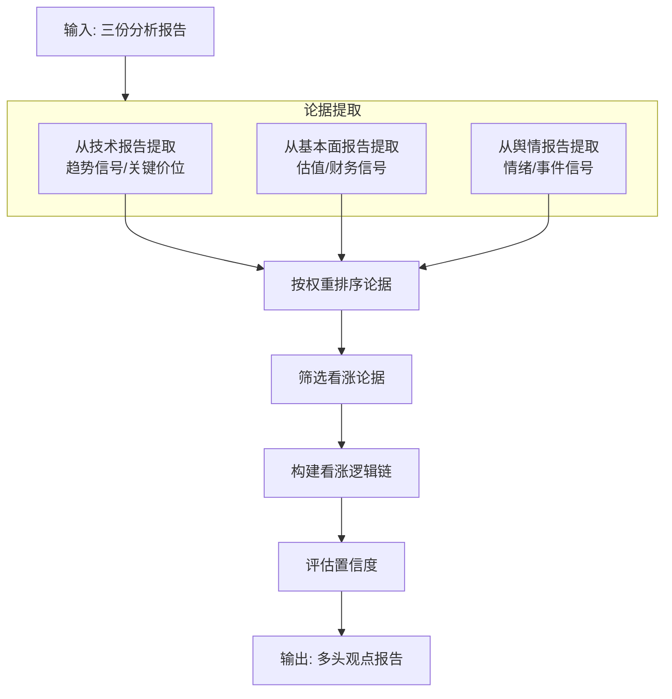

# 多头研究agent概要设计
## 数据源
一阶段汇总节点的state信息-StageOneMergeState

## 多头研究agent结构设计

## 系统提示词prompt设计

见文档：[多头研究agent系统提示词设计](docs\股票提示词设计集\多头agent的系统提示词设计.md)

## 工具集tools设计

tool1: 读取技术报告
func: read_technical_report
    params 
        state: BullishAgentState
    Returns:
        包含技术面信息的字典
tool2: 读取基本面报告
func: read_fundamental_report
    params 
        state: BullishAgentState
    Returns:
        包含基本面面信息的字典
tool3: 读取舆情报告
func: read_sentiment_report
    params 
        state: BullishAgentState
    Returns:
        包含舆情面信息的字典
tool4: 在分析报告中按关键词搜索相关内容。当需要在特定维度（如"估值"、"成长"、"政策"）查找信息时使用此工具。
func: search_report
    params 
        report_content: 报告内容字典
        keyword: 搜索关键词（如"ROE"、"PE"、"金叉"）
    Returns:
        包含相关内容结果的字典

## 结构化输出structure output设计
```python
# ============================================================
# 子模型：支撑论据
# ============================================================
class SupportingArgument(BaseModel):
    """单条支撑论据的结构"""
    pass
# ============================================================
# 子模型：置信度分解
# ============================================================
class ConfidenceBreakdown(BaseModel):
    """置信度的多维分解"""
    pass
# ============================================================
# 主模型：多头观点报告
# ============================================================
class BullishReport(BaseModel):
    """
    多头观点报告的结构, 内部要有上面定义的下属类型字段
    """
    pass
```
上述仅供参考，实际实现中可能需要根据具体需求进行调整。
## 状态state设计

```python
class BullishAgentState:
    """多头研究员Agent的状态 - 支持ReAct循环追踪"""
    
    # ============================================================
    # 1. 输入参数（来自阶段一汇聚结果）
    # ============================================================
    workflow_id: str
    ts_code: str
    symbol: str                           # 用户友好代码，用于报告展示
    # 三份原始报告（只读）
    technical_report: Dict[str, Any] = field(default_factory=dict)
    fundamental_report: Dict[str, Any] = field(default_factory=dict)
    sentiment_report: Dict[str, Any] = field(default_factory=dict)
    # 三维度得分
    technical_score: float = 0.0
    fundamental_score: float = 0.0
    sentiment_score: float = 0.0
    # ============================================================
    # 2. ReAct 消息历史（核心新增）
    # ============================================================
    messages: Annotated[List[BaseMessage], add_messages] = field(default_factory=list)
    # 标准 ReAct 消息格式:
    # [
    #   {"role": "system", "content": "你是一个专业的多头研究员..."},
    #   {"role": "user", "content": "请分析以下报告..."},
    #   {"role": "assistant", "content": "让我先看技术面报告", "tool_calls": [...]},
    #   {"role": "tool", "tool_call_id": "xxx", "content": "{\"trend\": \"上涨\"}"},
    #   {"role": "assistant", "content": "技术面确认向上，我再看看基本面...", "tool_calls": [...]},
    #   {"role": "tool", "tool_call_id": "yyy", "content": "{\"valuation_status\": \"低估\"}"},
    #   {"role": "assistant", "content": "已收集足够证据，生成报告...", "tool_calls": null},
    #   {"role": "assistant", "content": "{\"summary\": \"...\", ...}"}  # 最终输出
    # ]
    
    context_summary: Optional[str] = None  # 上下文压缩时的摘要，非必需但推荐
    # ============================================================
    # 3. ReAct 循环控制状态
    # ============================================================
    reasoning_round: int = 0              # 当前推理轮次
    max_rounds: int = 6                   # 最大轮次
    is_complete: bool = False             # 是否完成推理
    exit_reason: Optional[str] = None     # 退出原因: max_rounds / confidence_high / evidence_sufficient / llm_finish
    # ============================================================
    # 4. 思考链记录（完整推理过程，用于审计和调试）
    # ============================================================
    thought_history: List[Dict[str, Any]] = field(default_factory=list)
    # 每条记录格式:
    # {
    #   "round": 1,
    #   "thought": "技术面MA5上穿MA20形成金叉，这是短期看涨信号",
    #   "action": "read_technical_report",
    #   "action_input": {"section": "trend"},
    #   "observation": "均线系统呈现多头排列，支撑位11.8元"
    # }
    # ============================================================
    # 5. 证据收集（ReAct核心产出）
    # ============================================================
    evidence_collected: List[Dict[str, Any]] = field(default_factory=list)
    # {
    #   "source": "technical",       # technical/fundamental/sentiment
    #   "point": "MA5上穿MA20形成金叉",
    #   "weight": 8,                 # 1-10 论据权重
    #   "quote": "均线系统呈现多头排列",
    #   "timestamp": "2026-08-31"
    # }
    # ============================================================
    # 6. 逻辑链构建
    # ============================================================
    logical_chain: List[str] = field(default_factory=list)
    # [
    #   "核心逻辑：公司基本面稳健且估值合理，技术面确认突破",
    #   "支撑逻辑1：均线多头排列，趋势向上确认",
    #   "支撑逻辑2：ROE高于行业均值，盈利能力强",
    #   "支撑逻辑3：舆情积极，市场共识增强"
    # ]
    identified_gaps: List[str] = field(default_factory=list)
    # ["缺乏近期机构调研数据", "未考虑行业整体估值下行风险"]
    counter_arguments: List[str] = field(default_factory=list)
    # ["大股东减持可能带来短期压力", "RSI接近超买区间"]
    
    # ============================================================
    # 7. 置信度评估
    # ============================================================
    confidence: float = 0.0               # 0-100 综合置信度
    confidence_factors: Dict[str, float] = field(default_factory=dict)
    # {
    #   "evidence_quality": 80,      # 证据质量
    #   "reasoning_depth": 75,       # 逻辑深度
    #   "counter_addressed": 60,     # 反方观点处理程度
    #   "multi_dimension_consistency": 85  # 多维度一致性
    # }
    
    # ============================================================
    # 8. 最终输出：多头观点报告
    # ============================================================
    bull_report: Optional[Dict[str, Any]] = field(default_factory=dict)
    # 结构见下方 "结构化输出设计"
    # ============================================================
    # 9. 执行元数据
    # ============================================================
    node_execution_status: Dict[str, str] = field(default_factory=dict)
    # {
    #   "evidence_extraction": "success",
    #   "logical_chain": "success",
    #   "confidence_eval": "success",
    #   "report_gen": "success"
    # }
    error_message: Optional[str] = None
    started_at: Optional[datetime] = None
    completed_at: Optional[datetime] = None
    execution_duration_ms: Optional[int] = None
    total_tokens_used: Optional[int] = None
    
```

## 上下文context设计

全局的ReActContext类作为阶段二的上下文处理器。
要有以下方法：
- `add_message`：添加消息到上下文
```python
def add_message(self, role: str, content: str):
        """添加消息到上下文"""
        pass
```
- `get_messages`：获取当前上下文消息
```python
def get_messages(self) -> List[BaseMessage]:
        """获取当前上下文消息"""
        pass
```
- `_should_compress`：判断是否需要压缩上下文
```python
def _should_compress(self) -> bool:
        """判断是否需要压缩上下文"""
        pass
```
- `_compress_messages`：压缩上下文消息
```python
def _compress_messages(self):
        """压缩上下文 - 保留system + 最近的完整轮次"""
        pass
```
- `_generate_summary`：生成历史消息的摘要
```python
def _generate_summary(self, messages: List[Dict]) -> str:
        """生成历史消息的摘要（可调用LLM或规则提取）"""
        pass
```
- `_estimate_tokens`：估算文本的token数
```python
def _estimate_tokens(self, text: str) -> int:
        """估算文本的token数（简单估算，中文约1.5字/token）"""
        pass
```
