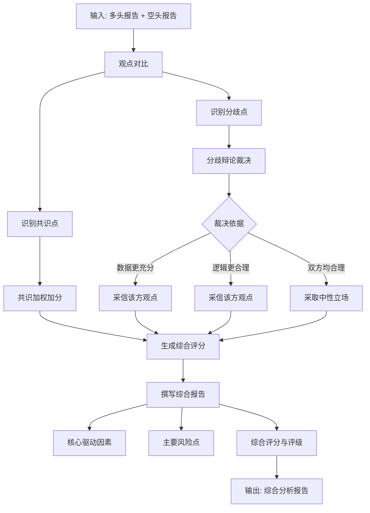

# 研究经理agent概要设计
## 数据源
阶段二多空研究员的输出报告：
- 多头研究员输出报告（BullishAgentState.bull_report）
- 空头研究员输出报告（BearishAgentState.bear_report）

## 研究经理agent结构设计

## 系统提示词prompt设计

见文档：[研究agent系统提示词设计](docs\股票提示词设计集\研究agent的系统提示词设计.md)

## 工具集tools设计

tool1: 读取多头观点报告
func: read_bull_report
    params 
        state: ResearchManagerState
    Returns:
        包含多头观点信息的字典
tool2: 读取空头观点报告
func: read_bear_report
    params 
        state: ResearchManagerState
    Returns:
        包含空头观点信息的字典
tool3: 在观点报告中按关键词搜索相关内容。当需要在特定维度（如"估值"、"风险"、"论据"）查找信息时使用此工具。
func: search_report
    params 
        report_content: 报告内容字典
        keyword: 搜索关键词（如"ROE"、"金叉"、"减持"）
    Returns:
        包含相关内容结果的字典

## 结构化输出structure output设计
```python
# ============================================================
# 子模型：共识点
# ============================================================
class ConsensusPoint(BaseModel):
    """多空双方达成共识的观点"""
    pass
# ============================================================
# 子模型：分歧裁决
# ============================================================
class DebateResolution(BaseModel):
    """对分歧点的裁决结果"""
    pass
# ============================================================
# 子模型：综合评分分解
# ============================================================
class ScoreBreakdown(BaseModel):
    """综合评分的多维分解"""
    pass
# ============================================================
# 主模型：综合分析报告
# ============================================================
class ComprehensiveReport(BaseModel):
    """
    研究经理的综合分析报告结构, 内部要有上面定义的下属类型字段
    """
    pass
```
上述仅供参考，实际实现中可能需要根据具体需求进行调整。
## 状态state设计

```python
class ResearchManagerState:
    """研究经理Agent的状态 - 支持ReAct循环追踪"""
    
    # ============================================================
    # 1. 输入参数（来自多空研究员输出）
    # ============================================================
    workflow_id: str
    ts_code: str
    symbol: str                           # 用户友好代码，用于报告展示
    # 多空双方报告（只读）
    bull_report: Dict[str, Any] = field(default_factory=dict)
    bear_report: Dict[str, Any] = field(default_factory=dict)
    # 三维度得分（辅助参考）
    technical_score: float = 0.0
    fundamental_score: float = 0.0
    sentiment_score: float = 0.0
    # ============================================================
    # 2. ReAct 消息历史
    # ============================================================
    messages: Annotated[List[BaseMessage], add_messages] = field(default_factory=list)
    context_summary: Optional[str] = None  # 上下文压缩时的摘要，非必需但推荐
    # ============================================================
    # 3. ReAct 循环控制状态
    # ============================================================
    reasoning_round: int = 0              # 当前推理轮次
    max_rounds: int = 6                   # 最大轮次
    is_complete: bool = False             # 是否完成推理
    exit_reason: Optional[str] = None     # 退出原因: max_rounds / debate_resolved / confidence_high / llm_finish
    # ============================================================
    # 4. 思考链记录（完整推理过程，用于审计和调试）
    # ============================================================
    thought_history: List[Dict[str, Any]] = field(default_factory=list)
    # ============================================================
    # 5. 对比分析：共识与分歧
    # ============================================================
    consensus_points: List[Dict[str, Any]] = field(default_factory=list)
    # {"point": "基本面稳健", "bull_view": "...", "bear_view": "...", "weight": 8}
    divergence_points: List[Dict[str, Any]] = field(default_factory=list)
    # {"point": "短期是否超买", "bull_view": "...", "bear_view": "...", "evidence": {...}}
    debate_resolutions: List[Dict[str, Any]] = field(default_factory=list)
    # {"point": "短期是否超买", "winner": "bull", "basis": "数据更充分", "reason": "..."}
    # ============================================================
    # 6. 综合评分
    # ============================================================
    comprehensive_score: float = 0.0      # 0-100 综合评分
    score_breakdown: Dict[str, float] = field(default_factory=dict)
    # {"technical": 72, "fundamental": 68, "sentiment": 65, "debate_adjust": 5}
    rating: Optional[str] = None          # 强烈看多/看多/中性/看空/强烈看空
    # ============================================================
    # 7. 最终输出：综合分析报告
    # ============================================================
    comprehensive_report: Optional[Dict[str, Any]] = field(default_factory=dict)
    # 结构见下方 "结构化输出设计"
    # ============================================================
    # 8. 执行元数据
    # ============================================================
    node_execution_status: Dict[str, str] = field(default_factory=dict)
    error_message: Optional[str] = None
    started_at: Optional[datetime] = None
    completed_at: Optional[datetime] = None
    execution_duration_ms: Optional[int] = None
    total_tokens_used: Optional[int] = None
    
```

## 上下文context设计

全局的ReActContext类作为阶段二的上下文处理器。
要有以下方法：
- `add_message`：添加消息到上下文
```python
def add_message(self, role: str, content: str):
        """添加消息到上下文"""
        pass
```
- `get_messages`：获取当前上下文消息
```python
def get_messages(self) -> List[BaseMessage]:
        """获取当前上下文消息"""
        pass
```
- `_should_compress`：判断是否需要压缩上下文
```python
def _should_compress(self) -> bool:
        """判断是否需要压缩上下文"""
        pass
```
- `_compress_messages`：压缩上下文消息
```python
def _compress_messages(self):
        """压缩上下文 - 保留system + 最近的完整轮次"""
        pass
```
- `_generate_summary`：生成历史消息的摘要
```python
def _generate_summary(self, messages: List[Dict]) -> str:
        """生成历史消息的摘要（可调用LLM或规则提取）"""
        pass
```
- `_estimate_tokens`：估算文本的token数
```python
def _estimate_tokens(self, text: str) -> int:
        """估算文本的token数（简单估算，中文约1.5字/token）"""
        pass
```
