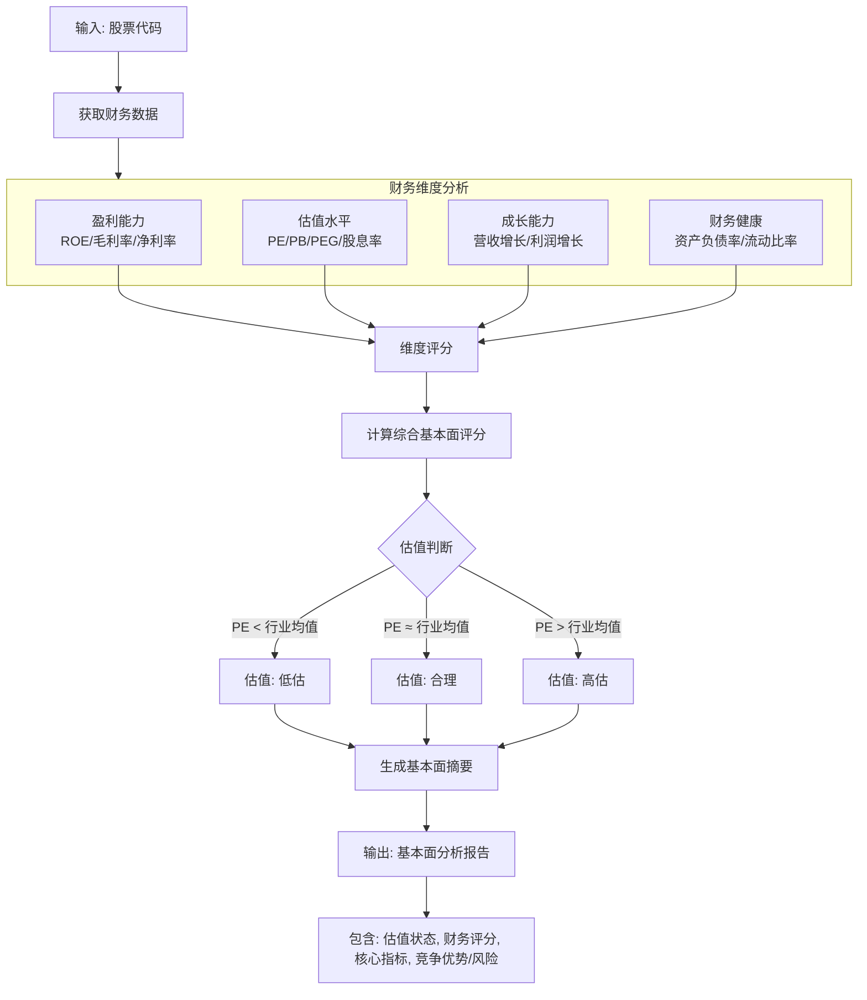

# 基本面分析agent概要设计
## 数据源
使用Tushare获取股票的基本面数据，包括财务指标、行业数据等。
外部api接口: fina_indicator

## 基本面分析agent结构设计

## agent节点设计

节点	节点类型	输入	输出	状态变更
F1: 数据获取	原子操作	{ts_code, ann_date, start_date, end_date, period} {financial_raw, valuation_raw}	(state.financial_raw = {...}, state.valuation_raw = {...})
F2: 维度评分	并行子节点	financial_raw	{profit, growth, health, combined}	state.dimension_scores = {...}
F3: 估值判断	规则引擎	valuation_raw	{status, pe, pb_percentile, pb, industry_pe_avg, valuation_gap}	state.valuation = {...}
F4: 报告生成	模板填充	dimension_scores, valuation	(fundamental_score, {score, valuation_status, summary, metrics, strengths, risks})	(state.fundamental_report = {...}, state.fundamental_score = ...)

其中，F2内部可拆分为3个并行子节点（盈利能力、成长能力、财务健康），各自独立计算后汇聚。
节点间连接方式：链式+并行——F1 → F2（F2内部并行）→ F3 → F4。

## 图状态维护
```python
class FundamentalAgentState:
    # 输入状态
    ts_code: str # TS股票代码,e.g. 600001.SH/000001.SZ
    ann_date: str # 日期格式为YYYYMMDD
    start_date: str # 日期格式为YYYYMMDD
    end_date: str # 日期格式为YYYYMMDD
    period: str # 报告期(每个季度最后一天的日期,比如20171231表示年报)
    # 条件
    # ...
    # 中间状态
    # ========== 节点1输出：原始数据 ==========
    financial_raw: Optional[Dict[str, Any]] = field(default_factory=dict)
    # {"roe": 15.2, "net_profit_margin": 12.3, "gross_margin": 35.6, ...}
    valuation_raw: Optional[Dict[str, Any]] = field(default_factory=dict)
    # {"pe": 12.5, "pb": 1.8, "ps": 2.1, ...}
    # ========== 节点2输出：维度评分 ==========
    dimension_scores: Optional[Dict[str, float]] = field(default_factory=dict)
    # {"profit": 75, "growth": 68, "health": 62, "combined": 68.3}
    # ========== 节点3输出：估值判断 ==========
    valuation: Optional[Dict[str, Any]] = field(default_factory=dict)
    # {
    #   "status": "低估",       # 低估/合理/高估
    #   "pe": 12.5,
    #   "pe_percentile": 25,    # 历史分位数
    #   "pb": 1.8,
    #   "industry_pe_avg": 18.5,
    #   "valuation_gap": -32.4  # 偏离度百分比
    # }
    # ========== 节点4输出：最终报告 ==========
    fundamental_score: Optional[float] = None
    fundamental_report: Optional[Dict[str, Any]] = field(default_factory=dict)
    # {
    #   "score": 68,
    #   "valuation_status": "低估",
    #   "summary": "公司ROE高于行业平均，但负债率略高，当前估值偏低...",
    #   "metrics": {"roe": 15.2, "pe": 12.5, "debt_ratio": 45.0},
    #   "strengths": ["盈利能力稳定", "估值具有安全边际"],
    #   "risks": ["资产负债率偏高"]
    # }
    # ========== 节点状态元数据 ==========
    node_execution_status: Dict[str, str] = field(default_factory=dict)
    error_message: Optional[str] = None
    started_at: Optional[datetime] = None
    completed_at: Optional[datetime] = None
    execution_duration_ms: Optional[int] = None
```
