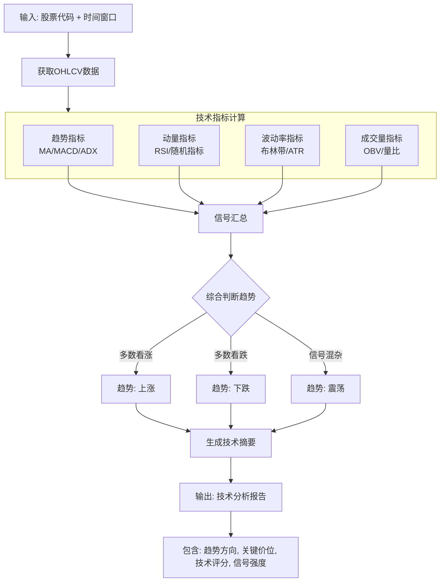

# 技术分析agent概要设计
## 数据源
使用Tushare获取股票的技术数据，包括K线图、指标数据等。
外部api接口: daily

## 技术分析agent结构设计

## agent节点设计

节点	节点类型	输入	输出	状态变更
F1: 数据获取	原子操作	{ts_code, start_date, end_date} {raw_ohlcv, data_record_count}	(state.raw_ohlcv = {...}, state.data_record_count = {...})
F2: 维度评分	并行子节点	raw_ohlcv	{ma, macd, rsi, bb, vol}	state.indicators = {...}
F3: 估值判断	规则引擎	indicators	{trend, strength, key_levels, signal_summary}	state.trend_analysis = {...}
F4: 报告生成	模板填充	trend_analysis	 (state.technical_report = {...}, state.technical_score = ...)

节点间连接方式：纯链式（Pipeline）——每个节点的输出是下一个节点的输入，无分支无循环。

## 图状态维护
```python
class TechnicalAgentState:
    # 输入参数
    ts_code: str # Tushare标准股票代码，如 "000001.SZ"
    start_date: str # 数据起始日期，格式 YYYYMMDD，如 "20250101"                      
    end_date: str # 数据结束日期，格式 YYYYMMDD，如 "20260831"
    # ========== 节点1输出：原始数据 ==========
    raw_ohlcv: Optional[pd.DataFrame] = None   # 原始OHLCV数据
    data_record_count: Optional[int] = None    # 数据条数
    # ========== 节点2输出：技术指标 ==========
    indicators: Optional[Dict[str, Any]] = field(default_factory=dict)
    # 结构示例：
    # {
    #   "ma": {"ma5": 12.5, "ma10": 12.3, "ma20": 12.0, "ma60": 11.5},
    #   "macd": {"dif": 0.15, "dea": 0.10, "macd": 0.05},
    #   "rsi": {"rsi6": 65.2, "rsi12": 58.7, "rsi24": 55.3},
    #   "bb": {"upper": 13.2, "middle": 12.0, "lower": 10.8},
    #   "vol": {"volume_ratio": 1.2, "obv": 1234567}
    # }
    # ========== 节点3输出：趋势判断 ==========
    trend_analysis: Optional[Dict[str, Any]] = field(default_factory=dict)
    # 结构示例：
    # {
    #   "trend": "上涨",        # 上涨/下跌/震荡
    #   "strength": 72,         # 0-100
    #   "key_levels": {"support": 11.8, "resistance": 13.5},
    #   "signal_summary": {"buy_signals": 3, "sell_signals": 1, "neutral_signals": 2}
    # }
    # ========== 节点4输出：最终报告 ==========
    technical_score: Optional[float] = None    # 0-100 技术面综合评分
    technical_report: Optional[Dict[str, Any]] = field(default_factory=dict)
    # 结构示例：
    # {
    #   "score": 72,
    #   "trend": "上涨",
    #   "summary": "短期均线上穿长期均线，RSI处于强势区间...",
    #   "key_metrics": {"rsi": 65, "macd_signal": "买入", "bb_position": "中轨上方"},
    #   "key_levels": {"support": 11.8, "resistance": 13.5}
    # }
    # ========== 执行元数据 ==========
    node_execution_status: Dict[str, str] = field(default_factory=dict)
    # {"data_fetch": "success", "indicator_calc": "success", "trend_judge": "success", "report_gen": "success"}
    error_message: Optional[str] = None
    started_at: Optional[datetime] = None
    completed_at: Optional[datetime] = None
    execution_duration_ms: Optional[int] = None
```