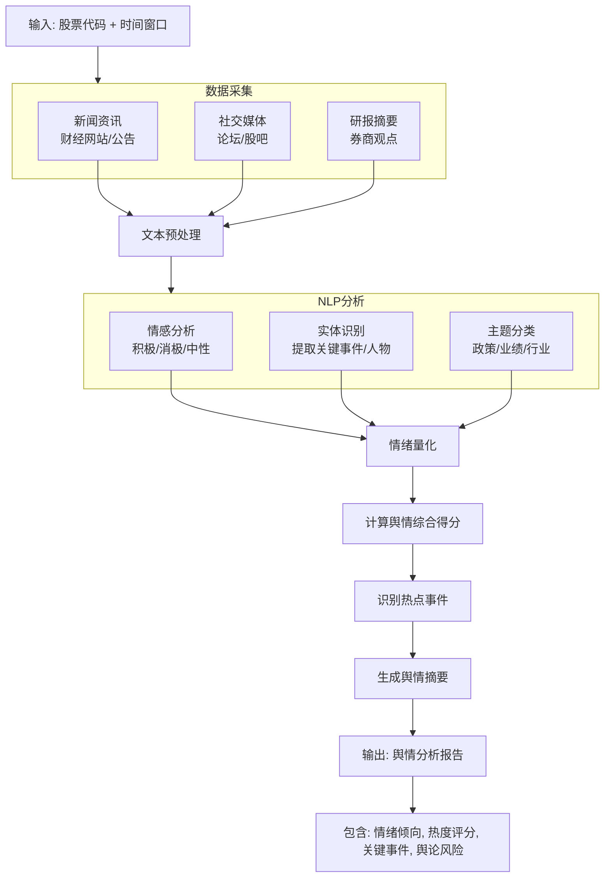

# 舆情数据分析agent概要设计
## 数据源
通过 akshare 获取股票的舆情数据（东方财富个股新闻）。
获取方式：调用 akshare 的 stock_news_em 接口，传入 6 位股票代码（如 000001），返回新闻列表。
结果写入 Redis 缓存（TTL），分析时优先命中缓存，降低重复请求。
数据访问格式:
```python
import akshare as ak

df = ak.stock_news_em(symbol="000001")  # 平安银行
# 返回字段：关键词、新闻标题、新闻内容、发布时间、文章来源、新闻链接
```

## 舆情数据分析agent结构设计

## agent节点设计

节点	节点类型	输入	输出	状态变更
S1: 数据采集	可执行节点	start_date, end_date, src	{news_list, social_posts}	(state.social_raw = {...}, state.news_count = {...}, state.posts_count = {...})
S2: NLP分析	原子操作	social_raw	{sentiments, entities, topics}	state.nlp_results = {...}
S3: 情绪量化	规则引擎	nlp_results	{sentiment_score, sentiment_distribution, heat_score, polarity}	state.sentiment = {...}
S4: 报告生成	模板填充	sentiment	{sentiment_report}	state.sentiment_report = {...}

节点间连接方式：链式——S1 → S2 → S3 → S4。

## 图状态维护
```python
class SentimentAgentState:
    # 输入参数
    start_date: str # 开始日期
    end_date: str # 结束日期
    src: str # 数据来源
    # ========== 节点1输出：原始数据 ==========
    social_raw: Optional[Dict[str, Any]] = field(default_factory=dict)
    # {
    #   "news_list": [{"title": "...", "content": "...", "src": "...", "datetime": "..."}],
    #   "social_posts": [{"text": "...", "platform": "...", "interaction_count": 123}]
    # }
    news_count: Optional[int] = None
    posts_count: Optional[int] = None
    # ========== 节点2输出：NLP分析结果 ==========
    nlp_results: Optional[Dict[str, Any]] = field(default_factory=dict)
    # {
    #   "sentiments": [
    #     {"text": "...", "sentiment": "positive", "score": 0.85},
    #   ],
    #   "entities": ["公司A", "政策B", "产品C"],
    #   "topics": {"业绩": 3, "政策": 2, "行业": 1}
    # }
    # ========== 节点3输出：情绪量化 ==========
    sentiment: Optional[Dict[str, Any]] = field(default_factory=dict)
    # {
    #   "sentiment_score": 65.0,           # 0-100
    #   "sentiment_distribution": {"positive": 45, "neutral": 35, "negative": 20},
    #   "heat_score": 72.0,                # 0-100 热度
    #   "polarity": "积极"                  # 积极/中性/消极
    # }
    # ========== 节点4输出：最终报告 ==========
    sentiment_score: Optional[float] = None
    sentiment_report: Optional[Dict[str, Any]] = field(default_factory=dict)
    # {
    #   "score": 65,
    #   "polarity": "积极",
    #   "summary": "近期舆情整体积极，财报利好引发市场关注，但需注意大股东减持传闻...",
    #   "key_events": ["公司发布超预期财报", "行业政策利好", "大股东减持"],
    #   "hot_topics": ["业绩增长", "政策支持"],
    #   "risk_factors": ["减持传闻"]
    # }
    # ========== 执行元数据 ==========
    node_execution_status: Dict[str, str] = field(default_factory=dict)
    error_message: Optional[str] = None
    started_at: Optional[datetime] = None
    completed_at: Optional[datetime] = None
    execution_duration_ms: Optional[int] = None
```