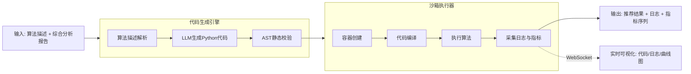

# 代码生成与沙箱执行引擎概要设计
## 数据源
- 用户自定义算法描述（自然语言或伪代码）
- 阶段二研究经理输出的综合分析报告（ResearchManagerState.comprehensive_report，作为算法输入数据参考）

## 引擎结构设计
引擎由「代码生成引擎（ReAct）」与「沙箱执行器（硬编码）」两段组成，并通过 WebSocket 事件流连接前端实时可视化。

## agent节点设计

节点	节点类型	输入	输出	状态变更
C1: 算法描述解析	原子操作	{algorithm_description}	{parsed_spec}	state.parsed_spec = {...}
C2: 代码生成	ReAct智能体	parsed_spec, comprehensive_report	{generated_code}	state.generated_code = {...}
C3: AST静态校验	规则引擎	generated_code	{validation_result}	state.ast_validation = {...}
S1: 容器创建	原子操作	generated_code, resource_limits	{container_id}	state.container_id = {...}
S2: 代码编译	原子操作	container_id, generated_code	{compile_result}	state.compile_result = {...}
S3: 执行算法	原子操作	container_id	{execution_result}	state.execution_result = {...}
S4: 日志指标采集	原子操作	container_id	{logs, metric_series}	state.logs = {...}, state.metric_series = {...}

节点间连接方式：链式（Pipeline）——C1 → C2 → C3 → S1 → S2 → S3 → S4，无分支无循环。其中 C2 内部为 ReAct 循环。

## 系统提示词prompt设计

见文档：[代码生成agent系统提示词设计](docs\股票提示词设计集\代码生成agent的系统提示词设计.md)

## 工具集tools设计

tool1: 读取综合分析报告
func: read_comprehensive_report
    params 
        state: CodeGenState
    Returns:
        包含综合评分、评级、核心驱动因素等信息的字典
tool2: 读取三维度得分
func: read_scores
    params 
        state: CodeGenState
    Returns:
        包含技术/基本面/舆情三维度得分的字典
tool3: 校验生成代码的语法与安全性
func: validate_code
    params 
        code: 生成的Python代码字符串
    Returns:
        包含校验结果（是否通过、错误信息、风险点）的字典

## 结构化输出structure output设计
```python
# ============================================================
# 子模型：算法输入定义
# ============================================================
class AlgorithmInput(BaseModel):
    """自定义算法的一个输入参数定义"""
    pass
# ============================================================
# 子模型：算法输出定义
# ============================================================
class AlgorithmOutput(BaseModel):
    """自定义算法的一个输出定义"""
    pass
# ============================================================
# 主模型：生成代码
# ============================================================
class GeneratedCode(BaseModel):
    """
    LLM 生成的推荐算法代码结构, 内部要有上面定义的下属类型字段
    """
    pass
```
上述仅供参考，实际实现中可能需要根据具体需求进行调整。

## 状态state设计

```python
class CodeGenSandboxState:
    """代码生成与沙箱执行引擎状态"""
    # ============================================================
    # 1. 输入参数
    # ============================================================
    workflow_id: str
    ts_code: str
    symbol: str
    algorithm_description: str                 # 用户算法描述（自然语言/伪代码）
    comprehensive_report: Dict[str, Any] = field(default_factory=dict)  # 综合分析报告
    technical_score: float = 0.0
    fundamental_score: float = 0.0
    sentiment_score: float = 0.0
    # ============================================================
    # 2. 代码生成阶段输出
    # ============================================================
    parsed_spec: Optional[Dict[str, Any]] = field(default_factory=dict)
    # {"intent": "综合评分加权", "inputs": [...], "outputs": [...], "logic": "..."}
    generated_code: Optional[Dict[str, Any]] = field(default_factory=dict)
    # {"code": "...", "language": "python", "entry_point": "recommend", "dependencies": [...]}
    ast_validation: Optional[Dict[str, Any]] = field(default_factory=dict)
    # {"passed": True, "errors": [], "risk_points": []}
    # ============================================================
    # 3. 沙箱执行阶段输出
    # ============================================================
    container_id: Optional[str] = None
    compile_result: Optional[Dict[str, Any]] = field(default_factory=dict)
    # {"passed": True, "message": "编译通过"}
    execution_result: Optional[Dict[str, Any]] = field(default_factory=dict)
    # {"exit_code": 0, "action": "买入", "score": 72.3, "result_json": {...}}
    logs: List[Dict[str, Any]] = field(default_factory=list)
    # [{"seq": 1, "level": "info", "message": "...", "timestamp": "..."}]
    metric_series: List[Dict[str, Any]] = field(default_factory=list)
    # [{"metric_name": "score", "step": 1, "value": 72.3, "timestamp": "..."}]
    # ============================================================
    # 4. 执行元数据
    # ============================================================
    node_execution_status: Dict[str, str] = field(default_factory=dict)
    error_message: Optional[str] = None
    started_at: Optional[datetime] = None
    completed_at: Optional[datetime] = None
    execution_duration_ms: Optional[int] = None
    total_tokens_used: Optional[int] = None
```

## 沙箱执行器配置（概要）
- 隔离方式：Docker 容器沙箱，每次执行创建独立容器，执行结束后销毁。
- 资源限制：CPU、内存、执行超时、网络禁用、文件系统只读。
- 安全策略：AST 静态校验 + 容器双层防护，拦截危险导入与系统调用。
