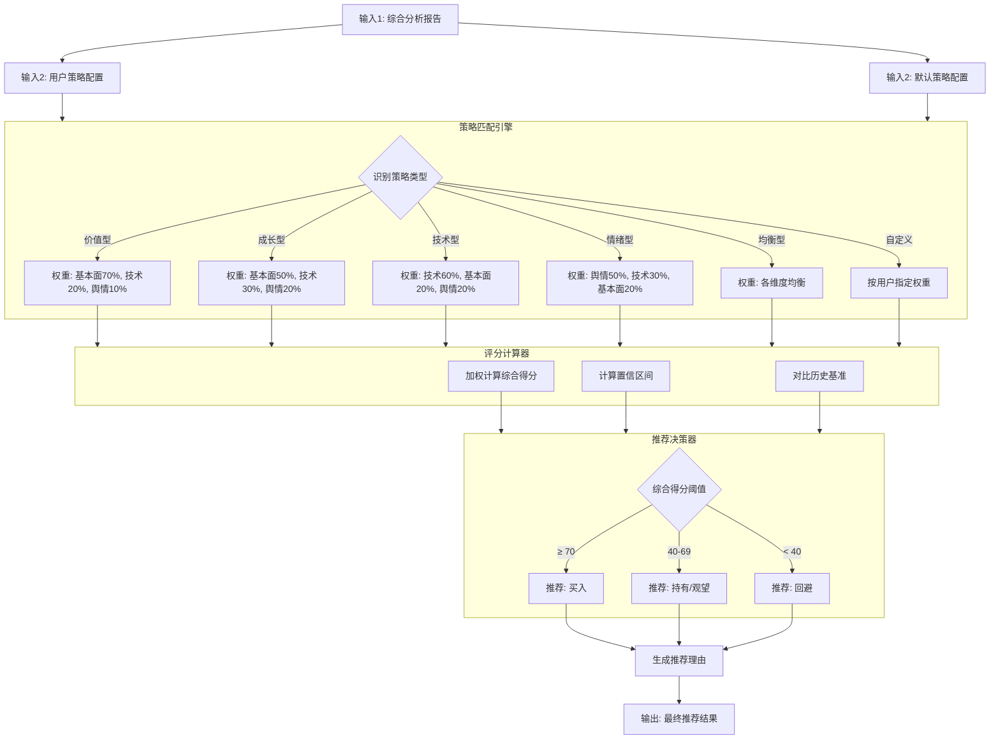

# 策略执行agent概要设计
## 数据源
- 阶段二研究经理输出的综合分析报告（ResearchManagerState.comprehensive_report）
- 用户策略配置或默认策略配置（策略类型与各维度权重）
- 用户自定义算法描述（自定义算法模式下，作为代码生成引擎的输入）

## 策略执行agent结构设计

## agent节点设计

节点	节点类型	输入	输出	状态变更
S1: 策略匹配	规则引擎	{comprehensive_report, strategy_config}	{strategy_type, weights}	(state.strategy = {...})
S2: 评分计算	原子操作	strategy	{weighted_score, confidence_interval, benchmark_diff}	state.scoring = {...}
S3: 推荐决策	规则引擎	scoring	{action, score, confidence, reasons}	state.recommendation = {...}
S4: 报告生成	模板填充	recommendation	{final_report}	state.final_report = {...}

节点间连接方式：纯链式（Pipeline）——每个节点的输出是下一个节点的输入，无分支无循环。

## 图状态维护
```python
class StrategyAgentState:
    # 输入参数
    workflow_id: str
    ts_code: str
    symbol: str
    comprehensive_report: Optional[Dict[str, Any]] = field(default_factory=dict)  # 来自研究经理
    strategy_config: Optional[Dict[str, Any]] = field(default_factory=dict)         # 用户/默认策略配置
    # 三维度得分（用于加权计算）
    technical_score: float = 0.0
    fundamental_score: float = 0.0
    sentiment_score: float = 0.0
    # ========== 节点1输出：策略匹配 ==========
    strategy: Optional[Dict[str, Any]] = field(default_factory=dict)
    # {"strategy_type": "价值型", "weights": {"fundamental": 0.7, "technical": 0.2, "sentiment": 0.1}}
    # ========== 节点2输出：评分计算 ==========
    scoring: Optional[Dict[str, Any]] = field(default_factory=dict)
    # {"weighted_score": 72.3, "confidence_interval": [65.0, 79.6], "benchmark_diff": 3.2}
    # ========== 节点3输出：推荐决策 ==========
    recommendation: Optional[Dict[str, Any]] = field(default_factory=dict)
    # {"action": "买入", "score": 72.3, "confidence": "中", "reasons": [...]}
    # ========== 节点4输出：最终报告 ==========
    final_report: Optional[Dict[str, Any]] = field(default_factory=dict)
    # {"action": "买入", "score": 72.3, "rating": "看多", "reasons": "...", "risk_tips": "..."}
    # ========== 执行元数据 ==========
    node_execution_status: Dict[str, str] = field(default_factory=dict)
    error_message: Optional[str] = None
    started_at: Optional[datetime] = None
    completed_at: Optional[datetime] = None
    execution_duration_ms: Optional[int] = None
```

## 自定义算法模式
当用户选择「自定义算法」时，策略执行不走本 agent 的默认硬编码管线，而是切换到「代码生成与沙箱执行引擎」管线：LLM 生成代码 → AST 校验 → Docker 沙箱编译执行，并实时展示代码、日志与曲线图。

详见文档：[代码生成与沙箱执行引擎概要设计](docs\业务智能体工作流文档集\概要设计文档集\策略执行与推荐生成\代码生成与沙箱执行引擎概要设计.md)
