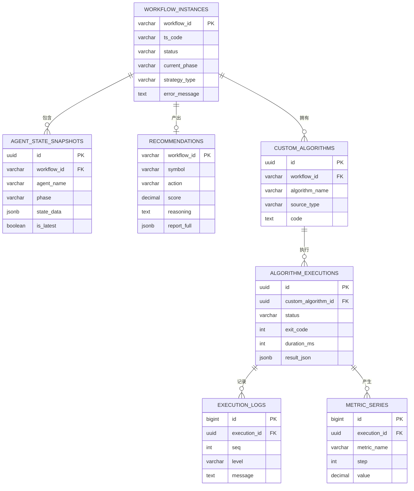

# 节点状态信息与运行时数据持久化设计

## 数据库选择

PostgreSQL

## 表设计
workflow_instances (工作流“档案卡”)

定位：记录每一次分析任务的整体信息。它就像一个任务的“档案卡”，告诉你这次任务分析的是哪只股票、使用了什么策略、当前进行到了哪个阶段（status）、什么时候开始的、有没有出错。

关键作用：用于全局追踪和管理。当你想查看“最近有哪些任务失败了？”或者“某个任务现在进行到哪一步了？”时，查询这张表是最快的。

agent_state_snapshots (工作流“工作底稿”)

定位：存储每一个Agent执行完毕后的完整状态快照。这是整个系统实现断点续传和审计追溯的核心。

关键作用：它记录了每个Agent分析时产生的所有内部数据。比如，技术分析师Agent算出的MACD值、多头研究员Agent构建的看涨论据链，都会被完整地保存在这里。如果系统在阶段二崩溃，可以依靠这张表还原技术分析师和基本面分析师的状态，从阶段二继续执行，而不必重跑阶段一。

recommendations (工作流“最终报告”)

定位：存放系统最终的输出结果。这张表独立存在，方便用户快速查询历史推荐建议。

关键作用：它存储了最重要的结论：action (买入/持有/回避)、score (综合得分)、reasoning (推荐理由)。前端展示用户的“推荐历史”时，直接查询这张表即可，无需去解析 agent_state_snapshots 里复杂的JSONB数据。

custom_algorithms (自定义算法“脚本库”)

定位：存放用户提交或 LLM 生成的自定义推荐算法 Python 代码。

关键作用：作为自定义算法执行管线的输入源，支持算法版本管理与复用。

algorithm_executions (算法执行“记录”)

定位：记录每一次自定义算法的执行过程与结果，关联执行日志与指标序列。

关键作用：追溯某次自定义算法的编译、执行状态与最终产出。

execution_logs (算法执行“日志流”)

定位：按时间顺序存储执行过程中产生的日志。

关键作用：前端通过 WebSocket 实时展示执行日志，同时落库用于事后回放与审计。

metric_series (算法执行“指标序列”)

定位：存储执行过程中产生的指标时间序列，用于前端绘制分析曲线图。

关键作用：支持按时间/轮次维度存储自定义算法产出的指标（如收益率、评分、回撤）。

```sql
-- 1. 工作流实例表（元数据）
CREATE TABLE workflow_instances (
    workflow_id VARCHAR(64) PRIMARY KEY,
    ts_code VARCHAR(16) NOT NULL,
    status VARCHAR(32),        -- pending / running / stage1_done / completed / failed
    current_phase VARCHAR(16), -- stage1 / stage2 / stage3
    strategy_type VARCHAR(32),
    error_message TEXT,
    started_at TIMESTAMP,
    completed_at TIMESTAMP
);

-- 2. Agent状态快照表（工作底稿）
CREATE TABLE agent_state_snapshots (
    id UUID PRIMARY KEY,
    workflow_id VARCHAR(64) REFERENCES workflow_instances(workflow_id),
    agent_name VARCHAR(32),    -- technical / fundamental / bull / research_manager
    phase VARCHAR(16),         -- stage1 / stage2
    state_data JSONB NOT NULL, -- 完整的Agent State
    is_latest BOOLEAN,
    created_at TIMESTAMP
);

-- 3. 最终推荐报告表（结果）
CREATE TABLE recommendations (
    workflow_id VARCHAR(64) PRIMARY KEY REFERENCES workflow_instances(workflow_id),
    symbol VARCHAR(16),
    action VARCHAR(16),        -- buy / hold / sell
    score DECIMAL(5,2),
    reasoning TEXT,
    report_full JSONB,
    created_at TIMESTAMP
);

-- 4. 自定义算法脚本库
CREATE TABLE custom_algorithms (
    id UUID PRIMARY KEY,
    workflow_id VARCHAR(64) REFERENCES workflow_instances(workflow_id),
    algorithm_name VARCHAR(128),
    source_type VARCHAR(32),   -- llm_generated / user_written
    code TEXT NOT NULL,
    status VARCHAR(32),
    created_at TIMESTAMP
);

-- 5. 算法执行记录
CREATE TABLE algorithm_executions (
    id UUID PRIMARY KEY,
    custom_algorithm_id UUID REFERENCES custom_algorithms(id),
    status VARCHAR(32),        -- compiling / running / success / failed
    exit_code INT,
    duration_ms INT,
    result_json JSONB,
    started_at TIMESTAMP,
    completed_at TIMESTAMP
);

-- 6. 算法执行日志流
CREATE TABLE execution_logs (
    id BIGSERIAL PRIMARY KEY,
    execution_id UUID REFERENCES algorithm_executions(id),
    seq INT,
    level VARCHAR(16),
    message TEXT,
    timestamp TIMESTAMP
);

-- 7. 算法执行指标序列
CREATE TABLE metric_series (
    id BIGSERIAL PRIMARY KEY,
    execution_id UUID REFERENCES algorithm_executions(id),
    metric_name VARCHAR(64),
    step INT,
    value DECIMAL(18,6),
    timestamp TIMESTAMP
);
```

## ER 图


上述数据库表设计，满足了系统对节点状态信息与运行时数据的持久化需求。实际业务应考虑数据的索引、查询效率、事务一致性等因素，以确保系统的稳定性和性能。

## 状态快照版本与幂等
1. Schema 版本：`state_data` JSONB 内嵌 `schema_version` 字段，Agent 状态结构变更时递增版本；读取时按版本兼容性解析，旧版本可读但不重放。
2. 幂等语义：同一 `workflow_id` + `agent_name` 的重跑采用「覆盖式写入最新快照」（`is_latest` 标记最新，历史版本保留用于审计）；重放前先判定该 agent 是否已完成（`is_complete`），避免重复调用外部 API/LLM 产生重复成本。
3. 断点恢复：按 `current_phase` 定位断点，只重跑「未完成」的 agent，已完成的读取其 `is_latest=true` 快照。

## 事务边界
| 写入 | 事务策略 | 说明 |
|------|----------|------|
| workflow_instances 创建 | 单事务 | 任务提交时插入，status=pending |
| agent 状态快照 | 单事务 | agent 完成后写入 state_data + is_latest 标记 |
| 阶段状态更新 | 与快照同事务 | 更新 workflow_instances.current_phase / status |
| recommendations | 单事务 | 最终结果写入，独立于快照 |
| custom_algorithms | 单事务 | 算法脚本保存 |
| algorithm_executions + execution_logs + metric_series | 异步批量 | 日志/指标高频写入，批量插入，不与主流程同事务 |

## 索引设计
| 表 | 索引 | 说明 |
|----|------|------|
| workflow_instances | (ts_code), (status), (started_at) | 按标的/状态/时间查询 |
| agent_state_snapshots | (workflow_id, agent_name, is_latest) | 断点恢复定位最新快照 |
| recommendations | (created_at) | 推荐历史按时间排序 |
| custom_algorithms | (workflow_id) | 按任务查询算法 |
| algorithm_executions | (custom_algorithm_id, started_at) | 按算法查询执行历史 |
| execution_logs | (execution_id, seq) | 日志顺序回放 |
| metric_series | (execution_id, metric_name, step) | 曲线数据按指标查询 |