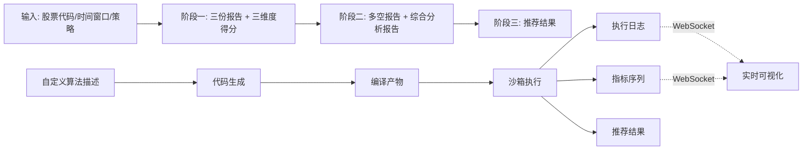

# 数据方面

## 概述
系统围绕股票推荐业务流转多种数据，按「输入数据 → 阶段产出 → 最终推荐 → 自定义算法数据」划分。本文描述各类数据的实体、来源与流转关系。

## 输入数据
| 数据 | 说明 | 来源 |
|------|------|------|
| 股票代码 ts_code | Tushare 标准股票代码（如 000001.SZ） | 用户输入 |
| 时间窗口 | 分析起止日期（YYYYMMDD） | 用户输入 |
| 策略配置 | 策略类型与各维度权重（价值/成长/技术/情绪/均衡/自定义） | 用户配置或默认配置 |
| 自定义算法描述 | 用户以自然语言或伪代码描述的推荐算法逻辑 | 用户输入（新增） |

## 阶段一产出
| 数据 | 说明 |
|------|------|
| 技术分析报告 technical_report | 趋势方向、关键价位、技术评分、信号强度 |
| 基本面分析报告 fundamental_report | 估值状态、财务评分、核心指标、优势/风险 |
| 舆情分析报告 sentiment_report | 情绪倾向、热度评分、关键事件、舆论风险 |
| 三维度得分 technical_score / fundamental_score / sentiment_score | 0-100 的量化评分 |

## 阶段二产出
| 数据 | 说明 |
|------|------|
| 多头观点报告 bull_report | 看涨摘要、核心逻辑、支撑论据、置信度 |
| 空头观点报告 bear_report | 看跌摘要、核心逻辑、支撑论据、置信度 |
| 综合分析报告 comprehensive_report | 评级、共识/分歧、综合评分、核心驱动因素与主要风险 |

## 阶段三产出
| 数据 | 说明 |
|------|------|
| 策略匹配结果 strategy | 策略类型与各维度权重 |
| 评分结果 scoring | 加权综合得分、置信区间、历史基准偏差 |
| 推荐决策 recommendation | 推荐动作（买入/持有/回避）、得分、理由 |
| 最终推荐报告 final_report | 面向用户展示的最终推荐结果 |

## 自定义算法数据（新增）
| 数据 | 说明 | 用途 |
|------|------|------|
| 自定义算法脚本 custom_algorithm | LLM 生成或用户手写的 Python 推荐算法代码 | 执行管线输入，支持版本管理 |
| 编译产物 | 代码编译校验的结果 | 判断代码是否可执行 |
| 执行日志 execution_log | 编译与执行过程中的日志流（含时间戳、级别） | WebSocket 实时展示 + 事后审计 |
| 指标序列 metric_series | 执行过程中产生的指标时间序列（收益率、评分、回撤等） | 前端绘制分析曲线图 |
| 算法执行记录 algorithm_execution | 单次执行的元信息（状态、退出码、耗时、结果） | 追溯与关联日志/指标 |

## 数据流转

