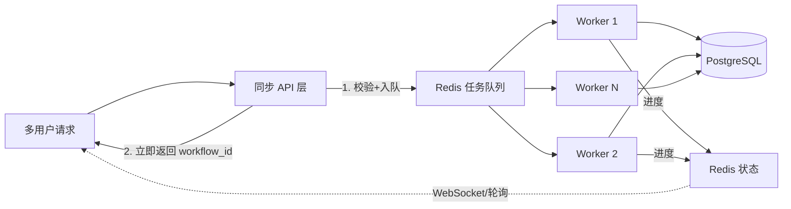

# 并发与任务调度设计

## 设计目标
保证多用户同时访问时的可用性与响应性：提交接口低延迟、任务有序执行、资源可控、故障可恢复。

## 核心架构：同步 + 异步分离

系统采用「同步 API 层 + 异步 Worker 层」分离，用 Redis 作为任务队列的中枢。

- **同步部分（API 层）**：接收请求 → 参数校验 → 生成 workflow_id → 任务入 Redis 队列 → 立即返回。不执行任何重计算，接口保持低延迟。
- **异步部分（Worker 层）**：多个 Worker 从 Redis 队列拉取任务，执行三阶段工作流，更新状态与结果。
- **状态/结果分离**：实时进度存 Redis（热数据），最终结果存 PostgreSQL（冷数据），前端可轮询/订阅获取进度。



## Redis 任务队列设计

| 键 | 类型 | 用途 |
|----|------|------|
| `task:queue` | List / Stream | 待处理任务队列（FIFO） |
| `task:{workflow_id}:status` | String | 任务状态（pending/running/completed/failed） |
| `task:{workflow_id}:progress` | Hash | 各阶段进度（stage1/stage2/stage3） |

任务消息结构：
```json
{
  "workflow_id": "wf_20260901_001",
  "ts_code": "000001.SZ",
  "strategy_type": "价值型",
  "start_date": "20250101",
  "end_date": "20260831",
  "submitted_at": "2026-09-01T10:00:00Z"
}
```

## Worker 设计

- **数量**：可配置，横向扩展（每个 Worker 独立进程/容器）。
- **消费模式**：`BRPOP task:queue` 阻塞式拉取（无任务时阻塞等待，低空转）。
- **并发度**：单 Worker 内用信号量限制同时处理的任务数，防止 LLM/沙箱资源被打满。
- **故障处理**：
  - 任务执行失败：重试有限次数（指数退避），仍失败则标记 `failed`。
  - Worker 崩溃：基于可见性超时，任务重新入队，避免任务丢失。
- **幂等**：以 `workflow_id` 去重；结合持久化层的断点恢复（`is_latest` 快照 + `current_phase`），重跑只重做未完成阶段。

## 同步异步时序

1. 用户提交 → API 校验参数 → 生成 `workflow_id` → `LPUSH task:queue` → 状态置 `pending` → 立即返回。
2. Worker `BRPOP` 拉取 → 状态置 `running` → 顺序执行阶段一/二/三。
3. 每阶段完成，更新 `task:{workflow_id}:progress` 与 `workflow_instances.current_phase`，并持久化快照。
4. 全部完成 → 状态置 `completed`，结果写入 `recommendations`。
5. 前端通过 WebSocket（实时）或轮询（降级）获取进度与结果。

## 并发控制

- **队列削峰**：任务排队，避免瞬时大量 LLM 调用压垮后端（LLM 是稀缺资源）。
- **API 限流**：按用户/令牌限流，防止恶意刷任务。
- **Worker 并发度**：限制单 Worker 并发，防止 Docker 沙箱并发创建过多容器。
- **优先级（可选）**：默认 FIFO，后续可引入优先级队列（如付费用户优先）。

## 可用性保障

| 措施 | 说明 |
|------|------|
| Worker 心跳 | 定期上报，失联则其任务重新入队 |
| 任务超时 | 单任务设全局超时，防止卡死 |
| 失败重试 | 指数退避，最多 N 次 |
| 幂等 | workflow_id 去重 + 断点恢复，避免重复扣费/重复执行 |
| 监控告警 | 队列深度、任务失败率、Worker 存活（见部署与运维） |

## 与持久化的关系

- **Redis**：承载「队列 + 实时状态 + 进度」（热数据，允许短时丢失）。
- **PostgreSQL**：承载「最终状态 + 快照 + 结果」（冷数据，持久）。
- 两者通过 `workflow_id` 关联，Redis 丢失可从 PostgreSQL 重建状态。
