# 智能股票推荐系统的需求分析

## 产品的设计初衷与目标

初衷：设计一款Web端的集成了前沿agent技术的智能股票推荐系统，目的是实现股票推荐、市场/技术分析、基本面分析、新闻分析、舆情分析等功能的整合。
核心功能使用工作流的设计，将不同功能模块的agent通过工作流进行协调，实现股票推荐的智能推荐。

目标：
1. 实现初衷中的所有功能，并让不同功能模块的agent相互协作，实现股票推荐的智能推荐。
2. 提供用户友好的界面，方便用户进行股票推荐、市场/技术分析、基本面分析、新闻分析、舆情分析等功能的使用。
3. 支持用户自定义推荐参数，实现个性化的股票推荐。
4. 支持调整推荐算法，根据用户自定义的推荐计算因子，实现推荐结果的个性化调整。
5. 支持用户在线自定义推荐算法：用户以自然语言或伪代码描述推荐逻辑，系统通过 LLM 在线生成 Python 代码，并在 Docker 沙箱中编译执行，实时展示代码生成过程、执行日志与分析曲线图。

自定义能力分为三个递进层级：
- 参数级（目标3）：调整推荐参数（如阈值、时间窗口）。
- 因子级（目标4）：调整推荐计算因子（如各维度权重）。
- 代码级（目标5）：在线生成并执行自定义推荐算法，作为独立的「算法实验室」子系统，与主流程异步解耦。

## 开发环境约束

1. **运行环境**：项目构建与运行使用本机 Python 环境（系统 Python 3.12），不使用虚拟环境。
2. **沙盒虚拟环境**：`.venv` 虚拟环境仅供沙盒工具临时使用，不作为项目运行环境。
3. **依赖安装**：项目缺失依赖直接安装到本机 Python 环境（`pip install <pkg>`）。
4. **模型服务**：LLM 使用本机 Ollama（`http://localhost:11434`），不安装 OpenAI SDK。
   - 调用方式：通过 `langchain-ollama` 的 `ChatOllama` 对象，使用 `bind_tools` 绑定工具、`with_structured_output` 约束结构化输出。
   - 可用对话模型：`qwen2.5:7b-instruct-q4_K_M`、`qwen3.5:0.8b`
   - 可用向量模型：`qwen3-embedding`（供 RAG 使用）

## 整体功能模块架构

```mermaid
flowchart TB
    %% 定义样式
    classDef userFill fill:#e1f5fe,stroke:#01579b,stroke-width:2px;
    classDef agentFill fill:#fff3e0,stroke:#e65100,stroke-width:2px;
    classDef dataFill fill:#e8f5e9,stroke:#1b5e20,stroke-width:2px;
    classDef titleFill fill:#f3e5f5,stroke:#4a148c,stroke-width:2px,font-weight:bold;

    %% 用户交互层（顶层）
    subgraph User_Layer[用户交互层]
        direction LR
        U1[自然语言查询] 
        U2[股票代码输入]
        U3[报告生成]
        U4[可视化图表]
        U5[算法编辑器]
        U6[代码生成视图]
        U7[执行日志]
        U8[分析曲线图]
    end

    %% 决策层（中间层）
    subgraph Agent_Layer[决策层 AlAgent]
        direction LR
        A1[技术分析师]
        A2[基本面分析师]
        A3[舆情分析师]
        A4[多头/空头研究员]
        A5[研究经理]
        A6[策略执行agent]
        A7[代码生成引擎]
        A8[沙箱执行器]
    end

    %% 数据接入层（底层）
    subgraph Data_Layer[数据接入层]
        direction LR
        D1[MCP插件](待补充，详细实现不涉及，但留出拓展空间)
        D2[行情API]
        D3[财经新闻API]
        D4[财务数据库]
        D5[舆情数据]
        D6[自定义算法脚本库]
    end

    %% 层级间的连接（带箭头）
    User_Layer --> Agent_Layer
    Agent_Layer --> Data_Layer

    %% 应用样式到具体节点
    class U1,U2,U3,U4,U5,U6,U7,U8 userFill;
    class A1,A2,A3,A4,A5,A6,A7,A8 agentFill;
    class D1,D2,D3,D4,D5,D6 dataFill;
    class User_Layer,Agent_Layer,Data_Layer titleFill;
```

### 架构视图说明
整体架构存在两个正交视角：
- 分层视图（上图）：用户交互层 / 决策层 / 数据接入层，描述系统的逻辑分层与依赖方向。
- 阶段视图（见「业务功能逻辑描述」）：阶段一（数据获取与基础分析）→ 阶段二（信息综合与辩论）→ 阶段三（策略执行与推荐生成），描述工作流的运行时编排顺序。

映射关系：

| 分层 | 阶段一 | 阶段二 | 阶段三 |
|------|--------|--------|--------|
| 决策层 AlAgent | 技术分析师 / 基本面分析师 / 舆情分析师 | 多头/空头研究员 / 研究经理 | 策略执行agent / 代码生成引擎 / 沙箱执行器 |
| 数据接入层 | Tushare 行情/财务、舆情本地库 | — | 自定义算法脚本库 |

## 系统架构目录结构
系统大体目录结构如下：
```
stock_recommendation/
│
├── README.md                          # 项目说明文档
├── requirements.txt                   # Python依赖
├── .env.example                       # 环境变量模板
├── docker-compose.yml                 # Docker编排（PostgreSQL + Redis）
├── pyproject.toml                     # 项目配置（可选）
│
├── config/                            # 配置模块
│   ├── __init__.py
│   ├── settings.py                    # 全局配置（数据库、API、模型等）
│   ├── logging_config.py              # 日志配置
│   └── prompts/                       # 系统提示词
│       ├── __init__.py
│       ├── bull_researcher.py         # 多头研究员System Prompt
│       ├── bear_researcher.py         # 空头研究员System Prompt
│       ├── research_manager.py        # 研究经理System Prompt
│       └── code_generator.py          # 代码生成器System Prompt
│
├── src/                               # 核心源代码
│   ├── __init__.py
│   │
│   ├── agents/                        # Agent实现
│   │   ├── __init__.py
│   │   ├── base.py                    # Agent基类 / ReAct引擎
│   │   ├── technical_analyst.py       # 技术分析师（硬编码）
│   │   ├── fundamental_analyst.py     # 基本面分析师（硬编码）
│   │   ├── sentiment_analyst.py       # 舆情分析师（硬编码）
│   │   ├── bull_researcher.py         # 多头研究员（ReAct）
│   │   ├── bear_researcher.py         # 空头研究员（ReAct）
│   │   ├── research_manager.py        # 研究经理（ReAct+裁决）
│   │   ├── strategy_executor.py       # 策略执行agent（硬编码）
│   │   └── code_generator.py          # 代码生成器（ReAct，LLM生成Python算法）
│   │
│   ├── tools/                         # ReAct Agent工具定义
│   │   ├── __init__.py
│   │   ├── report_readers.py          # 读取三份报告的工具
│   │   └── search_tools.py            # 跨报告搜索工具
│   │
│   ├── state/                         # 状态定义
│   │   ├── __init__.py
│   │   ├── global_state.py            # 全局工作流状态
│   │   ├── technical_state.py         # 技术分析师State
│   │   ├── fundamental_state.py       # 基本面分析师State
│   │   ├── sentiment_state.py         # 舆情分析师State
│   │   ├── stage_merge_state.py       # 阶段一汇聚State
│   │   ├── bull_state.py              # 多头研究员State
│   │   ├── bear_state.py              # 空头研究员State
│   │   ├── research_manager_state.py  # 研究经理State
│   │   └── strategy_state.py          # 策略执行State
│   │
│   ├── data/                          # 数据层
│   │   ├── __init__.py
│   │   ├── tushare_client.py          # Tushare API封装
│   │   ├── sentiment_client.py        # 舆情API/爬虫封装
│   │   └── cache.py                   # Redis缓存操作
│   │
│   ├── persistence/                   # 持久化层
│   │   ├── __init__.py
│   │   ├── database.py                # PostgreSQL连接管理
│   │   ├── repository.py              # 状态存储/读取操作
│   │   └── models.py                  # SQLAlchemy/ORM模型
│   │
│   ├── workflow/                      # 工作流编排（LangGraph）
│   │   ├── __init__.py
│   │   ├── graph.py                   # LangGraph图定义
│   │   ├── nodes.py                   # 图节点实现
│   │   └── runner.py                  # 工作流执行器
│   │
│   ├── llm/                           # LLM调用层
│   │   ├── __init__.py
│   │   ├── client.py                  # LLM客户端（Ollama/OpenAI）
│   │   ├── react_engine.py            # ReAct循环引擎
│   │   └── output_parser.py           # 结构化输出解析器
│   │
│   ├── codegen/                       # 代码生成引擎
│   │   ├── __init__.py
│   │   ├── generator.py               # LLM代码生成
│   │   ├── templates.py               # 代码模板
│   │   └── validator.py               # AST静态校验
│   │
│   ├── sandbox/                       # Docker沙箱执行
│   │   ├── __init__.py
│   │   ├── docker_client.py           # Docker容器管理
│   │   ├── executor.py                # 编译执行
│   │   └── resource_limits.py         # 资源限制配置
│   │
│   ├── streaming/                     # 实时日志/事件流推送
│   │   ├── __init__.py
│   │   ├── websocket.py               # WebSocket服务
│   │   └── event_bus.py               # 事件总线
│   │
│   └── utils/                         # 工具函数
│       ├── __init__.py
│       ├── logger.py                  # 日志工具
│       ├── validators.py              # 数据校验
│       ├── datetime_utils.py          # 日期格式转换
│       └── exceptions.py              # 自定义异常
│
├── scripts/                           # 脚本工具
│   ├── __init__.py
│   ├── init_db.py                     # 初始化数据库
│   ├── test_tushare.py                # 测试Tushare连接
│   └── test_workflow.py               # 测试完整工作流
│
├── logs/                              # 日志目录（运行时生成）
│   ├── app.log
│   └── workflow_20260831.log
│
├── tests/                             # 单元测试
│   ├── __init__.py
│   ├── test_agents/
│   │   ├── test_technical.py
│   │   └── test_bull_researcher.py
│   └── test_workflow/
│       └── test_full_pipeline.py
│
└── notebooks/                         # Jupyter Notebook（探索性分析）
    └── data_exploration.ipynb
```

## 业务功能逻辑描述

### 业务整体流程与职责分析
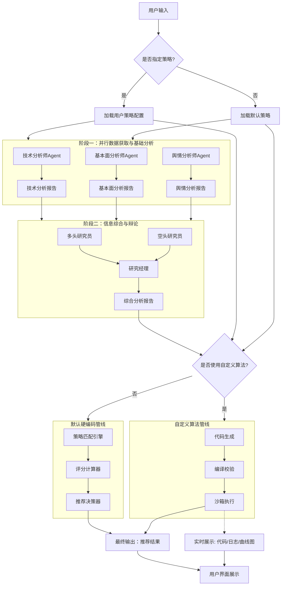
### 任务执行模型
推荐分析是长耗时任务（LLM 多轮推理 + Docker 沙箱执行），采用「Redis 任务队列 + 异步执行 + 事件推送」模型，保证多用户并发访问的可用性：
1. 用户提交任务（股票代码、策略/算法描述）→ 任务入 Redis 队列，立即返回 workflow_id（不阻塞）。
2. 后台 Worker 从队列拉取任务，异步执行三阶段；各阶段状态持久化到 workflow_instances，实时进度写入 Redis。
3. 前端通过 WebSocket 订阅 workflow_id，实时接收阶段进度、执行日志与指标序列。
4. 任务完成后，前端从 recommendations / metric_series 拉取最终结果与曲线数据。

多用户并发策略（详见《并发与任务调度设计》）：
- 同步部分（API 层）：只做参数校验 + 任务入队 + 返回 workflow_id，不执行重计算，保证接口低延迟。
- 异步部分（Worker 层）：多个 Worker 消费 Redis 任务队列，支持横向扩展与故障重试。
- 结果查询：状态与结果分离，前端可轮询/订阅获取进度，不占用长连接。
#### 数据获取与处理
##### 技术分析agent流程分析
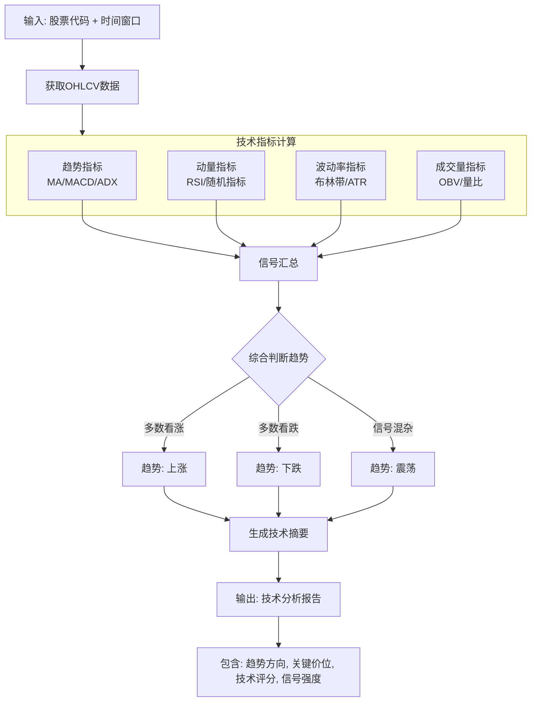
##### 基本面分析agent流程分析
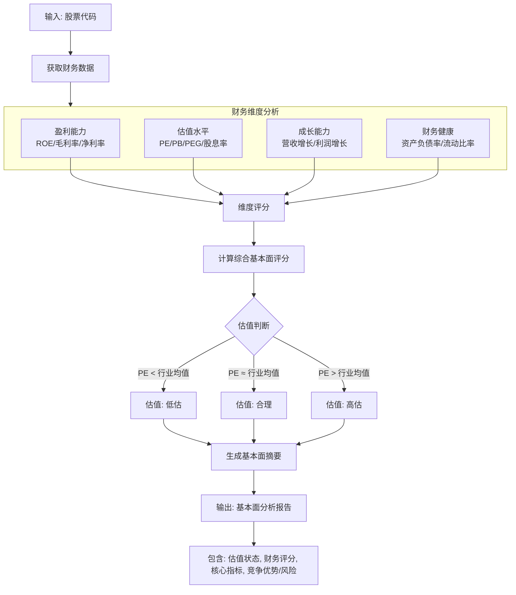
##### 舆情分析agent流程分析
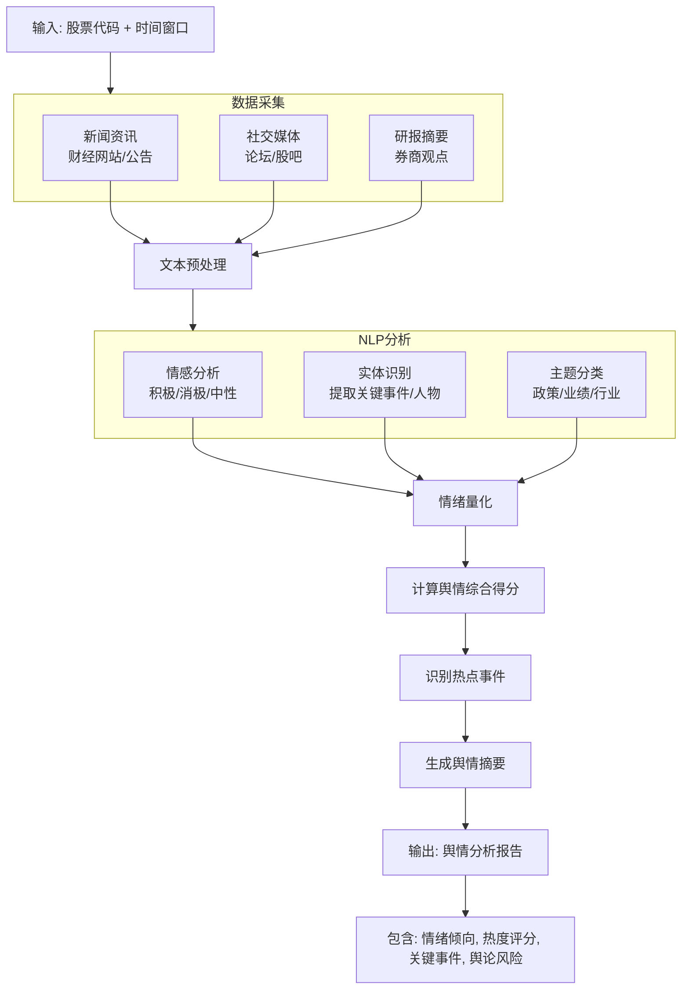
#### 信息综合与辩论生成
##### 多头/空头研究员agent流程分析
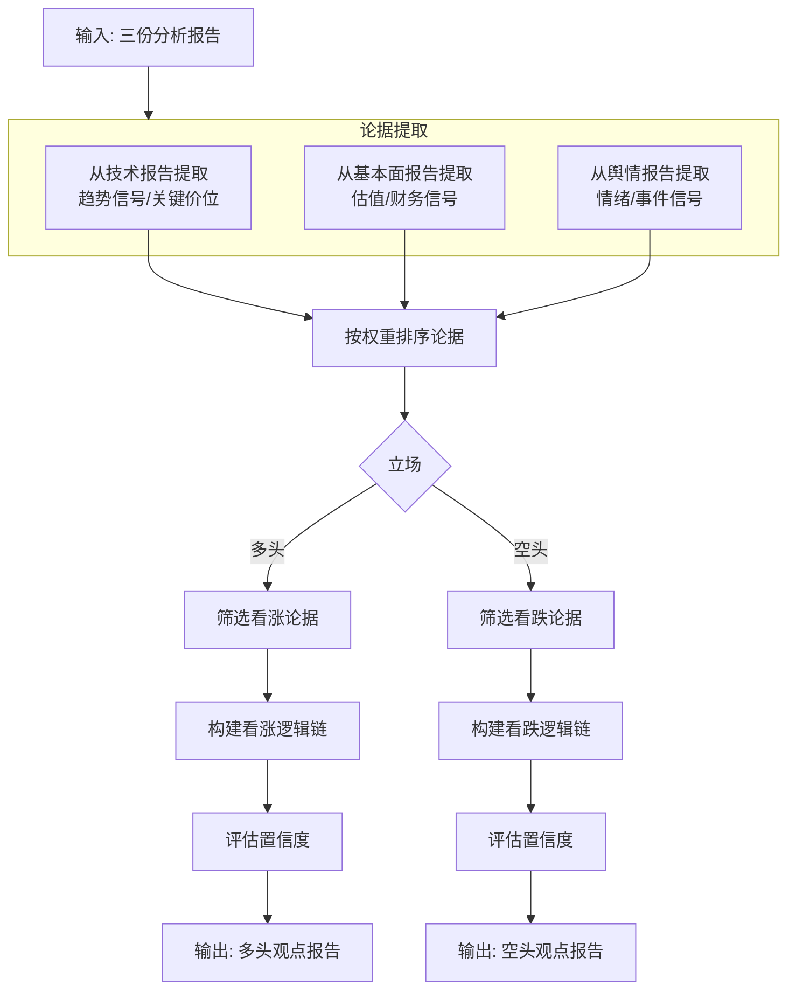
##### 研究经理agent流程分析
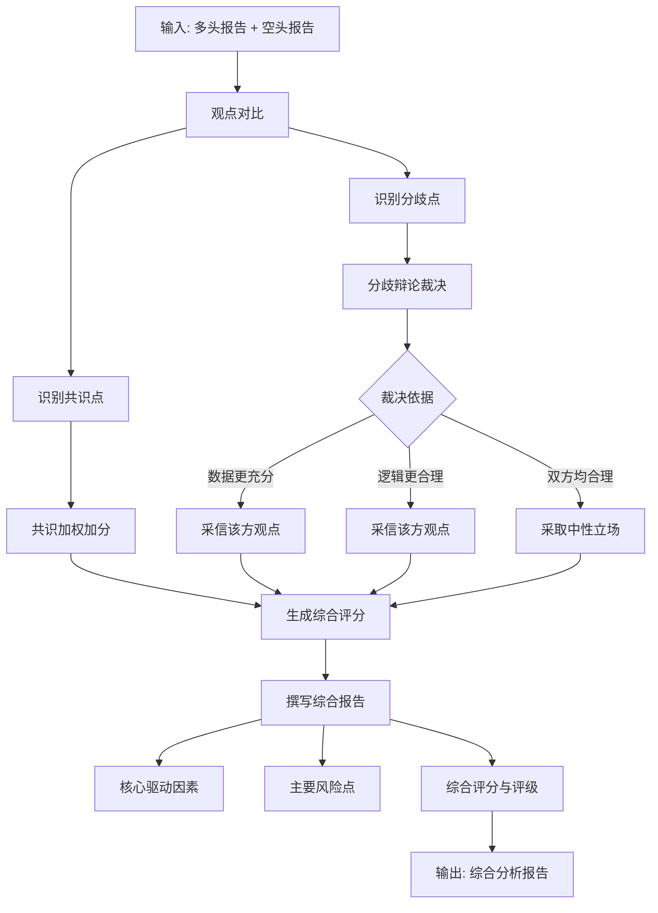
#### 策略执行与推荐生成
##### 策略执行agent流程分析
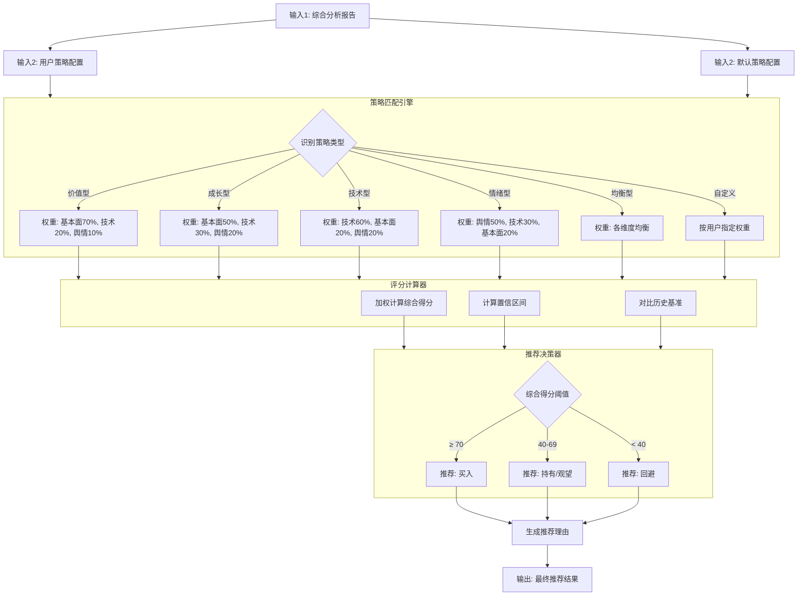

## 数据来源分析
### 数据获取与分析的数据源
#### 技术数据
使用Tushare获取股票的技术数据，包括K线图、指标数据等。
#### 基本面数据
使用Tushare获取股票的基本面数据，包括财务指标、行业数据等。
#### 舆情数据
舆情数据通过 akshare（东方财富个股新闻接口）获取，结果写入 Redis 缓存（TTL），分析时优先命中缓存，降低重复请求。
### 自定义算法与执行数据源
#### 自定义算法脚本
用户在页面以自然语言或伪代码描述推荐算法，由 LLM 在线生成 Python 代码；也支持用户直接编辑 Python 代码。
#### 编译与执行日志
代码编译、沙箱执行过程中产生的日志，通过 WebSocket 实时推送至前端。
#### 指标序列与曲线数据
自定义算法执行过程中产生的指标时间序列（如收益率曲线、评分变化），用于前端绘制分析曲线图。

## agent结构设计
系统整体编排方案如下图所示。
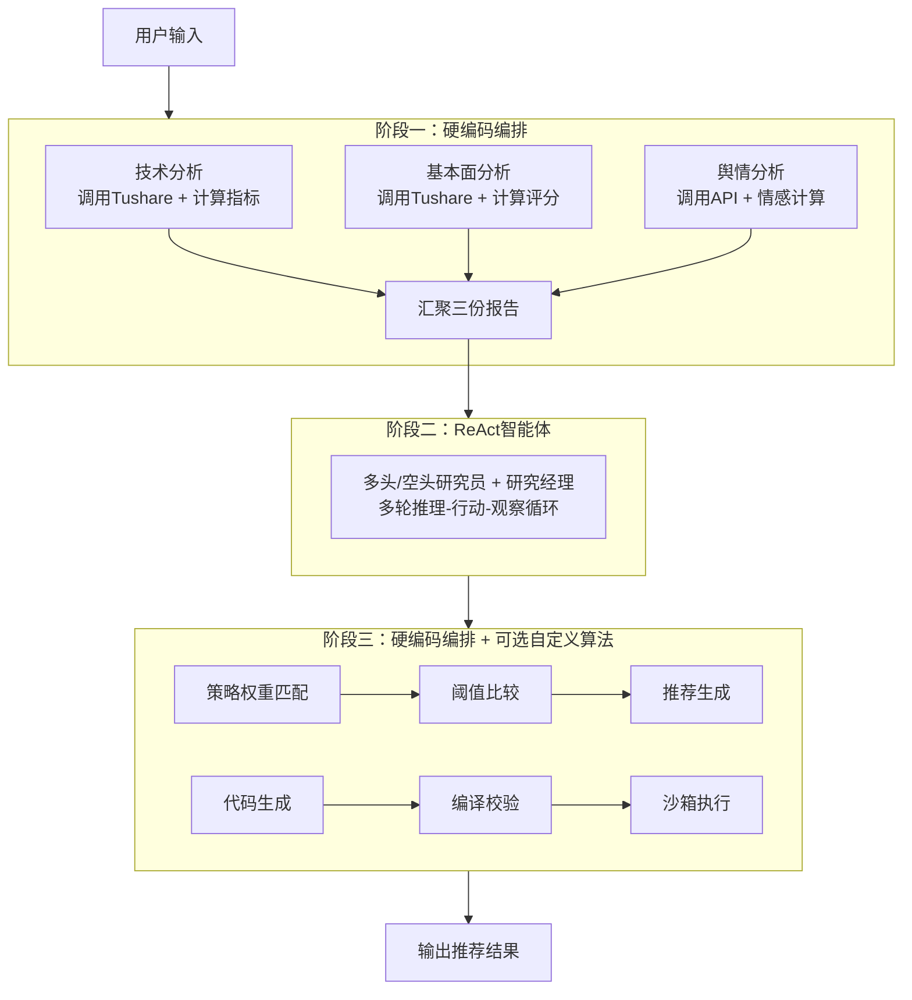
### 数据获取与处理
这一阶段采用硬编码编排，通过多个节点处理数据获取、指标计算、趋势判断和报告生成。
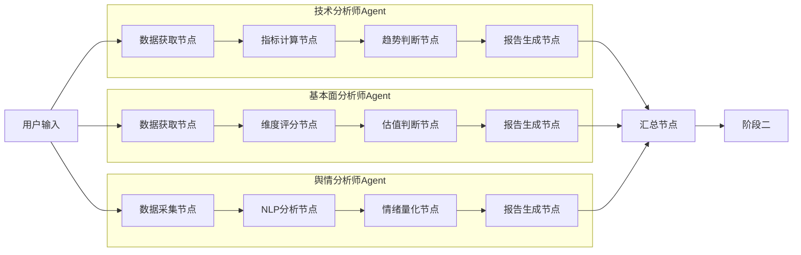
### 信息综合与辩论
这一阶段采用ReAct智能体，通过多轮推理-行动-观察循环，生成综合分析报告。
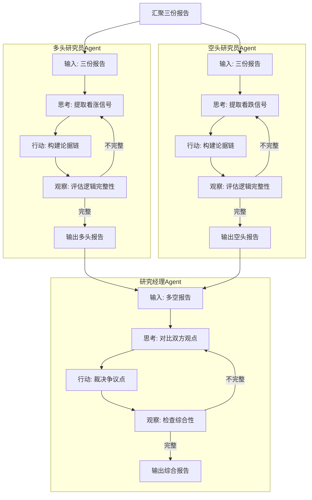
### 策略匹配与推荐生成
这一阶段采用确定性流程，不涉及AI推理循环，确保推荐结果的稳定性和可解释性。
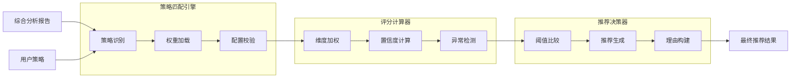
### 自定义算法在线执行
当用户选择「自定义算法」时，第三阶段走自定义算法管线：LLM 生成代码 → AST 校验 → Docker 沙箱编译执行 → WebSocket 实时推送日志与指标，前端同步展示代码、执行日志与分析曲线图。
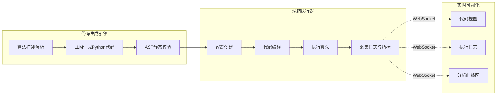

## 数据持久化设计

workflow_instances (工作流“档案卡”)

定位：记录每一次分析任务的整体信息。它就像一个任务的“档案卡”，告诉你这次任务分析的是哪只股票、使用了什么策略、当前进行到了哪个阶段（status）、什么时候开始的、有没有出错。

关键作用：用于全局追踪和管理。当你想查看“最近有哪些任务失败了？”或者“某个任务现在进行到哪一步了？”时，查询这张表是最快的。

agent_state_snapshots (工作流“工作底稿”)

定位：存储每一个Agent执行完毕后的完整状态快照。这是整个系统实现断点续传和审计追溯的核心。

关键作用：它记录了每个Agent分析时产生的所有内部数据。比如，技术分析师Agent算出的MACD值、多头研究员Agent构建的看涨论据链，都会被完整地保存在这里。如果系统在阶段二崩溃，可以依靠这张表还原技术分析师和基本面分析师的状态，从阶段二继续执行，而不必重跑阶段一。

recommendations (工作流“最终报告”)

定位：存放系统最终的输出结果。这张表独立存在，方便用户快速查询历史推荐建议。

关键作用：它存储了最重要的结论：action (买入/持有/回避)、score (综合得分)、reasoning (推荐理由)。前端展示用户的“推荐历史”时，直接查询这张表即可，无需去解析 agent_state_snapshots 里复杂的JSONB数据。

custom_algorithms (自定义算法“脚本库”)

定位：存放用户提交或 LLM 生成的自定义推荐算法 Python 代码。

关键作用：作为自定义算法执行管线的输入源，支持算法版本管理与复用。字段包含：id、workflow_id、algorithm_name、source_type（llm_generated/user_written）、code、status、created_at 等。

algorithm_executions (算法执行“记录”)

定位：记录每一次自定义算法的执行过程与结果。

关键作用：用于追溯某次自定义算法的编译、执行状态与最终产出，与 execution_logs、metric_series 关联。字段包含：id、custom_algorithm_id、status（compiling/running/success/failed）、exit_code、duration_ms、result_json、started_at、completed_at 等。

execution_logs (算法执行“日志流”)

定位：按时间顺序存储执行过程中产生的日志。

关键作用：前端通过 WebSocket 实时展示执行日志，同时落库用于事后回放与审计。字段包含：id、execution_id、seq、level、message、timestamp 等。

metric_series (算法执行“指标序列”)

定位：存储执行过程中产生的指标时间序列，用于前端绘制分析曲线图。

关键作用：支持按时间/轮次维度存储自定义算法产出的指标（如收益率、评分、回撤），前端据此渲染曲线。字段包含：id、execution_id、metric_name、step、value、timestamp 等。

形成统一的sql脚本，用于创建以上所有表。并建立索引，以优化查询效率。

## 前端设计

使用streamlit框架，快速构建系统交互界面。用户可以通过该界面提交分析任务、查看推荐结果、自定义算法等。
主要界面结构分为两部分：
- 系统登录界面
- 主界面
    - 左侧导航栏
        - 智能推荐分析
            - 顶部选项卡
                - 查询任务选择或输入
            - 中间内容区域
                - 查询结果数据展示 (默认走硬编排的推荐算法)
                - 数据可视化展示
                - 推荐结果展示
        - 自定义算法在线执行
            - 顶部选项卡
                - 自定义算法选择或输入
            - 中间内容区域
                - 左侧1/2区域
                    - 自定义算法代码展示
                    - 执行按钮
                    - 执行状态展示
                - 右侧1/2区域    
                    - 数据可视化展示
                    - 执行日志展示
                    - 推荐结果展示
        - 配置选项
            - 修改系统参数
                - llm模型选择
                - 系统参数调整
    
    
